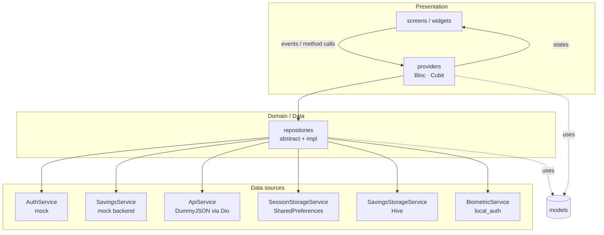
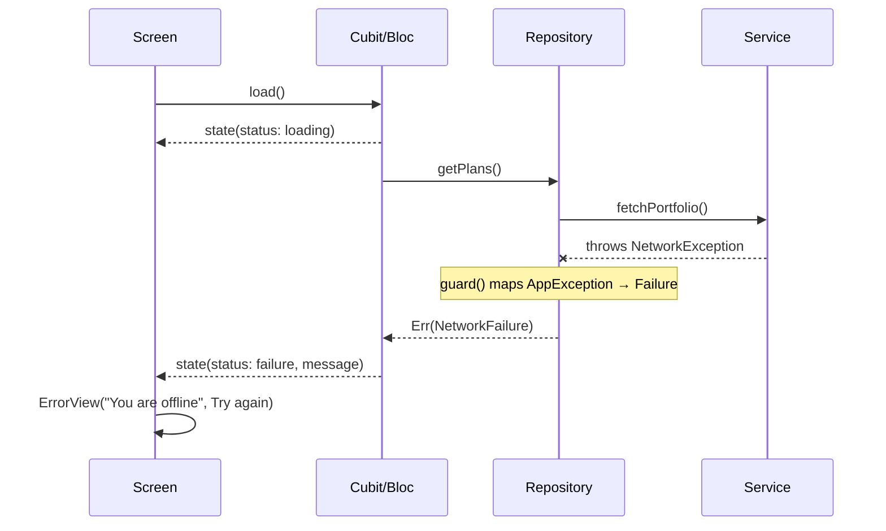

# Architecture

This document explains how Koins Savings is structured and why.

## Goals

1. **Follow the brief's folder structure** (`core`, `models`, `services`, `repositories`, `screens`, `widgets`, `utils`, `providers`).
2. **Apply clean-architecture layering inside it**: UI never talks to data sources, and business rules never live in widgets.
3. **Make every layer replaceable and testable**: each layer depends on abstractions and receives its dependencies through constructors.

## Layers

| Layer | Folder | Responsibility | Knows about |
|---|---|---|---|
| **UI** | `screens/`, `widgets/` | Render state, forward user intent, navigation, field-level validation | providers, models |
| **State** | `providers/` | Turn user intent into immutable states; no Flutter imports beyond `flutter_bloc` | repositories (interfaces), models |
| **Repository** | `repositories/` | Single source of truth per feature: combine sources, enforce business rules, cache, map errors to `Failure`s | services (interfaces), models |
| **Services** | `services/` | Talk to exactly one thing: HTTP, Hive, SharedPreferences, biometrics or the mock backend. Throw typed `AppException`s | models |
| **Models** | `models/` | Immutable value objects with JSON mapping | nothing |
| **Core** | `core/` | Theme, router, DI, error types, network client, constants | (shared) |

Every repository and service is an `abstract interface class` with one implementation, so swapping the mock backend for a real API, or Hive for SQLite, only touches the `services/` layer and the DI registration.

## Error flow

- **Services throw** typed `AppException`s (`NetworkException`, `ServerException`, `RequestTimeoutException`, `CacheException`, …).
- **Repositories never throw.** `guard()` wraps every call and returns a sealed `Result<T>` (`Ok` / `Err(Failure)`). Unknown errors become `UnexpectedFailure` and are logged.
- **Blocs `switch` exhaustively** on `Result`, so the compiler guarantees the failure path is handled.
- **UI** renders a shared `ErrorView` / `EmptyView` / `LoadingView` (or skeletons) depending on `ViewStatus`.

## Offline strategy

- **`NetworkInfo` answers "is the internet reachable?", not "is Wi-Fi on?".** It combines the OS network interface (`connectivity_plus`) with a reachability probe (a `HEAD` request to the backend), and a Dio `ReachabilityInterceptor` reports every request's outcome, so a DNS failure or captive portal flips the app offline at once. While offline it re-checks every 10 seconds. `ConnectivityCubit` turns its stream into app-wide state.
- **Read paths degrade gracefully.** `QuotesRepository` caches every successful response (`CacheStorageService`, Hive) and returns the cached copy wrapped in `CachedData` (with `savedAt`) when the network call fails. It fails only when nothing is cached.
- **Write paths fail fast.** `SavingsRepository.createPlan` runs a fresh connectivity check (`checkNow()`) first and returns a `NetworkFailure` instead of queuing the action. The UI also disables the button, but the rule lives in the repository.
- **The UI reacts, not polls.** `ConnectivityBanner` (root `MaterialApp.builder`) shows the offline strip, and `ReconnectListener` reloads screens when the state flips from offline to online.
- **The session is independent of the network**, so connectivity never logs anyone out.

## Navigation and session

- `go_router` with a **redirect guard** driven by `AuthCubit`. The router listens to the cubit's stream, so login and logout navigate automatically. No screen calls `go('/login')` after logout.
- `StatefulShellRoute.indexedStack` keeps each tab's navigation stack and scroll position (Home / Products / Profile).
- Full-screen flows (`/create-savings`) are pushed on the root navigator, above the bottom bar.
- `main()` restores the persisted session **before the first frame**, so a returning user lands directly on the dashboard.

## Reactive updates

`SavingsRepository` exposes `planChanges` (a broadcast stream). When a plan is created, the repository emits the updated list immediately (prepending to its last loaded list), and `DashboardCubit`, which is subscribed, updates without a manual refresh. The Create Savings screen doesn't need to know the dashboard exists.

## Dependency injection

`core/di/injection.dart` is the **composition root**. `get_it` registers lazy singletons for services and repositories. Only the composition root and screen-level `BlocProvider`s read from `getIt`; every class below that receives its collaborators through its constructor. This keeps classes pure and lets tests construct them directly with mocks.

## Key design decisions

| Decision | Reasoning |
|---|---|
| **Bloc/Cubit** | Explicit, immutable, testable state; the industry standard in fintech. A Cubit where intent is simple, a Bloc where events add clarity (products: load / search / filter). |
| **`Result` type instead of exceptions in the UI** | Makes failure handling explicit and compiler-checked. |
| **Money as `int`** | Avoids floating-point rounding errors. |
| **Business rules in the repository** | The minimum deposit and contribution ≤ target are enforced even if a future UI forgets to validate. The form validates too, for instant feedback. |
| **Hive storing JSON** | No generated adapters or `build_runner` step, so the project runs with just `flutter pub get`. |
| **Mock backend behind an interface** | Realistic latency for loading states, and a drop-in replacement point for a real API. |
| **Design tokens** (`AppColors`, `AppSpacing`, `AppRadius`, `Breakpoints`) | Consistent spacing, typography and colour; light and dark themes from one builder. |

## Testing strategy

| Level | Tooling | Examples |
|---|---|---|
| Unit (pure logic) | `flutter_test` | validators, formatters, calculator |
| Repository | `mocktail` | session persistence, biometric paths, business rules, error mapping, change stream |
| State | `bloc_test` | emitted state sequences for login, dashboard, products |
| Widget | `flutter_test` + mocked repositories via `get_it` | login validation and submit; create-savings validation → submit → success → navigation |
