# Koins Savings

A savings app for **Koins Microfinance Bank**, built with Flutter for the Flutter Developer technical assessment.

Users can sign in, see their savings dashboard, browse savings products, open a product's details, create a savings plan and manage their profile. The focus is clean architecture, a polished Material 3 UI, solid error handling and maintainable, tested code.

> **Demo credentials:** `test@bank.com` / `Password123`
> (tap the hint card on the login screen to fill them in)

---

## Contents

- [Screenshots](#screenshots)
- [Features](#features)
- [Getting started](#getting-started)
- [Architecture](#architecture)
- [State management: why Bloc](#state-management-why-bloc)
- [Local storage](#local-storage)
- [API integration](#api-integration)
- [Error handling](#error-handling)
- [Offline behaviour](#offline-behaviour)
- [Testing](#testing)
- [Packages used](#packages-used)
- [Assumptions](#assumptions)
- [Improvements with more time](#improvements-with-more-time)

---

## Screenshots

| Login | Validation | Dashboard | Recent savings + API |
|---|---|---|---|
| 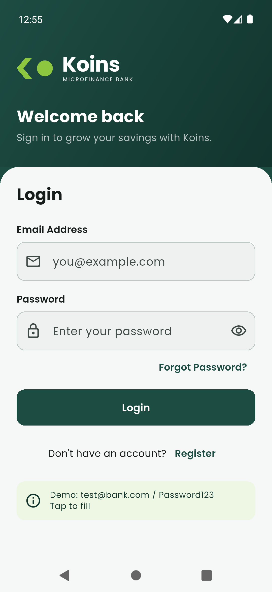 | 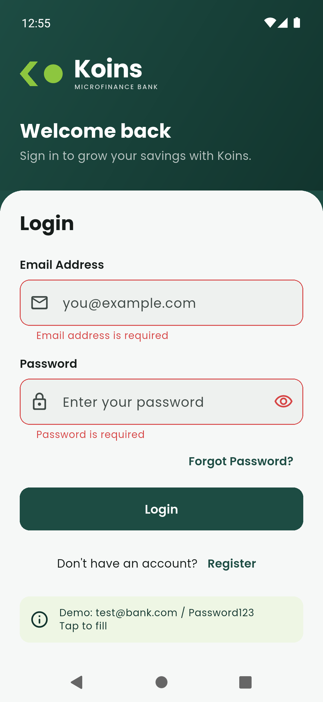 | 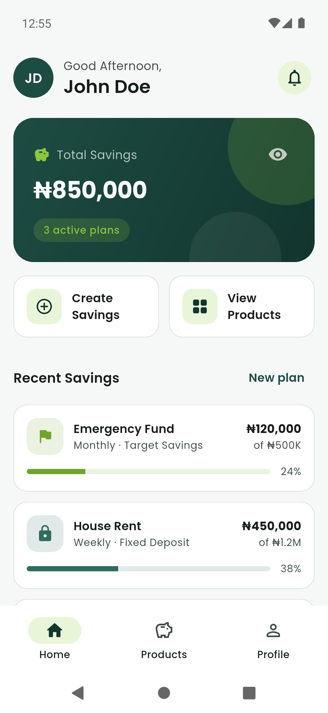 | 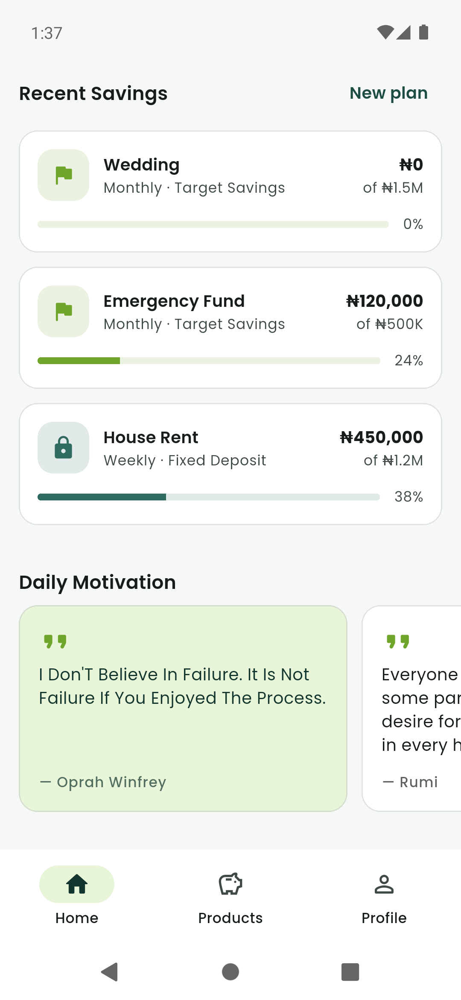 |

| Products | Filter | Product details | Create savings |
|---|---|---|---|
| 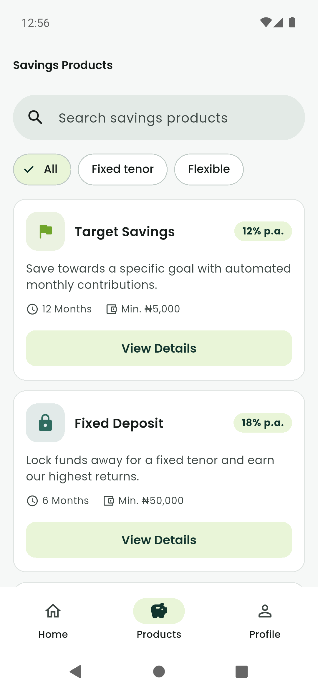 | 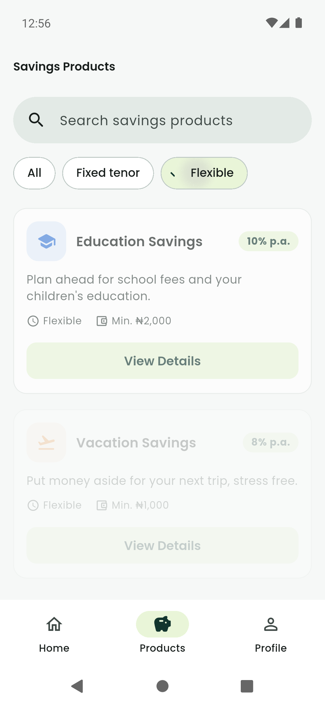 | 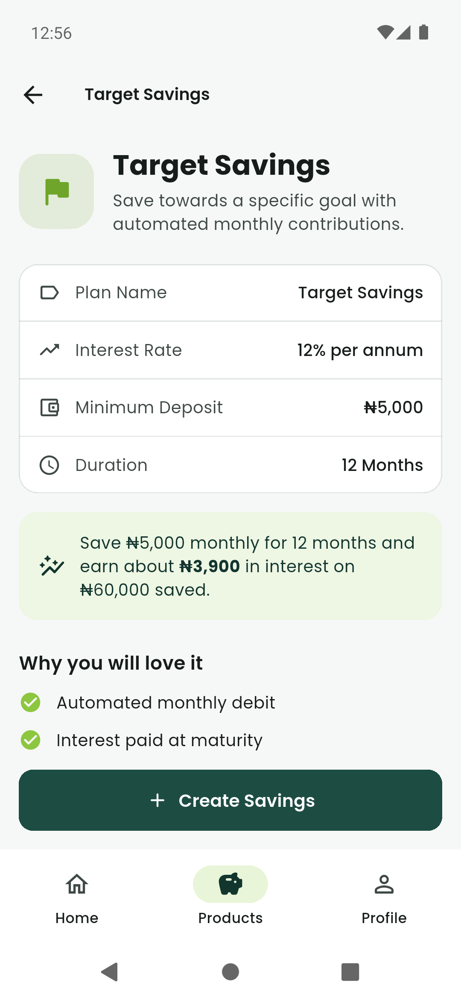 | 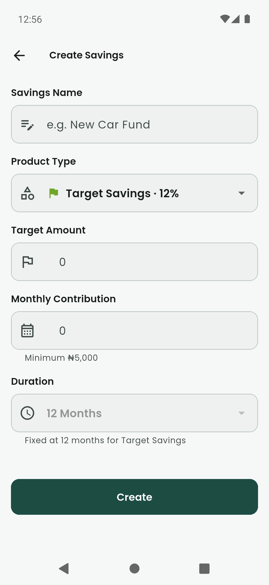 |

| Form validation | Live projection | Created | Profile |
|---|---|---|---|
| 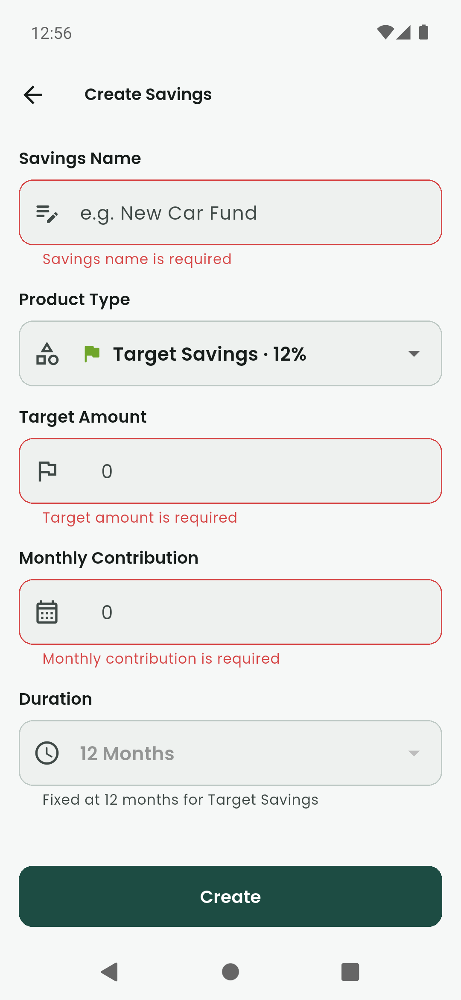 | 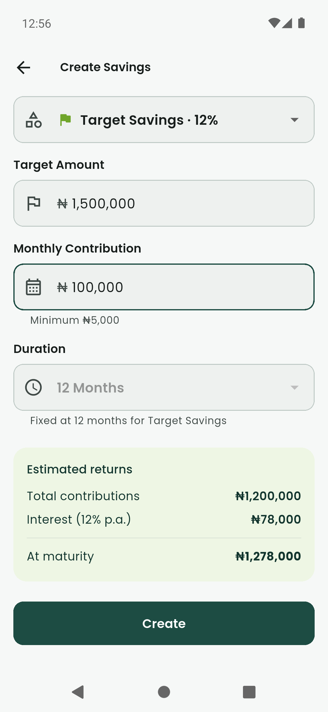 | 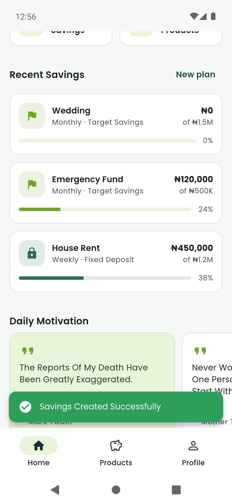 | 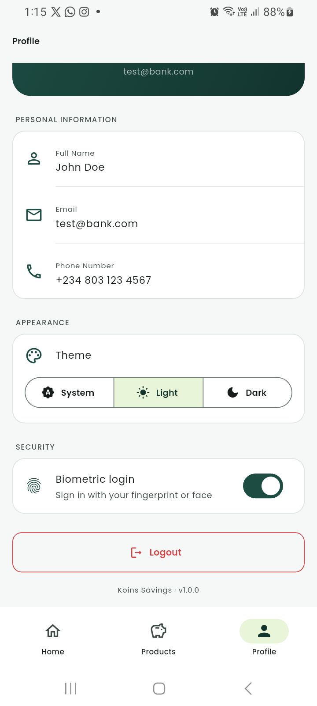 |

| Logout | Dark mode | Dark mode | Offline: saved data |
|---|---|---|---|
| 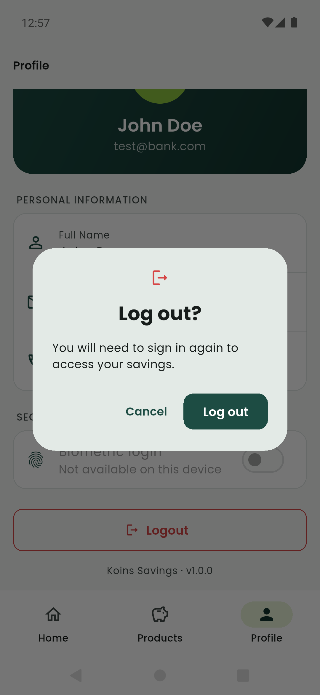 | 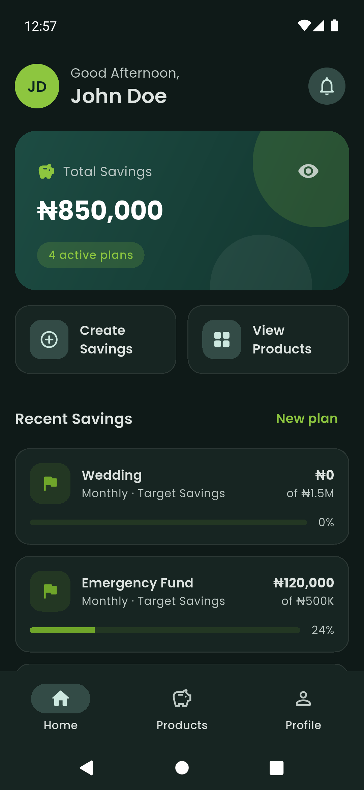 | 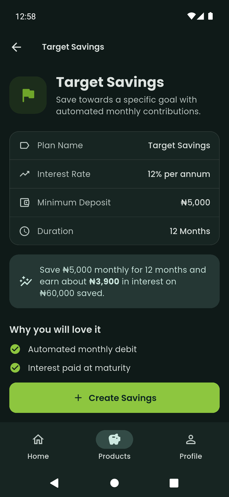 | 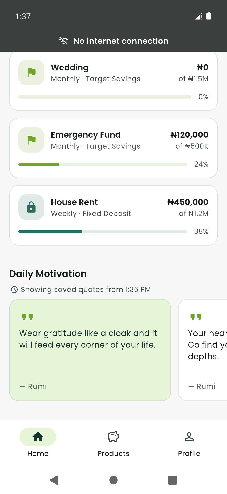 |

| Offline: Create blocked |
|---|
| 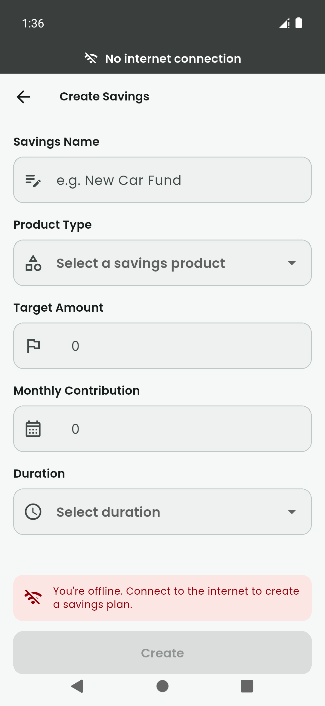 |

---

## Features

### Functional requirements

| Requirement | Implementation |
|---|---|
| **Login** | Email + password with required, email-format and min-8-character validation. Show/hide password, loading state, keyboard actions, autofill hints. Mock authentication against `test@bank.com` / `Password123`. Forgot Password and Register show a "coming soon" message. |
| **Dashboard** | Time-of-day greeting (`Good Morning/Afternoon/Evening, John Doe`), animated **₦850,000** total savings with a hide-balance toggle, the **Create Savings** and **View Products** quick actions, and the three most recent plans (name, amount, frequency, progress). |
| **Savings products** | Cards with name, interest rate, short description, tenor, minimum deposit and a **View Details** button. Includes the four products from the brief. |
| **Savings details** | Plan name, interest rate, minimum deposit, duration, a returns example and features, plus a **Create Savings** button that pre-selects the product. |
| **Create savings** | Savings name, product type (dropdown), target amount, monthly contribution and duration. All fields are required. On success it shows **"Savings Created Successfully"** and returns to the dashboard, where the new plan appears immediately. |
| **Profile** | Full name, email, phone number and **Logout** (with confirmation), which returns to Login. Also hosts the appearance (theme) and biometric login settings. |
| **API integration** | "Daily Motivation" feed on the dashboard, fetched from `https://dummyjson.com/quotes`. |
| **Local storage** | Logged-in user persisted with SharedPreferences; created plans persisted with Hive. |

### UI requirements

Material 3 · Koins brand theme (deep teal + lime) with **dark mode** and an in-app **System / Light / Dark** switch (remembered across launches) · responsive layout (bottom `NavigationBar` on phones, `NavigationRail` on tablets, 1–3 column product grid, width-capped forms) · 4pt spacing scale and a single type scale (Poppins) · icons throughout · loading indicators and skeleton loaders · empty states · error states with retry (including a dedicated offline state).

### Bonus features

- ✅ **Biometric login** (`local_auth`): enable it in Profile (you must confirm with your fingerprint first); after logging out a fingerprint button appears on the login screen. Tested on a Samsung Galaxy A13 (Android 13).
- ✅ **Pull to refresh** on the dashboard and products.
- ✅ **Search** savings products (name and description).
- ✅ **Filter** products by tenor (All / Fixed tenor / Flexible).
- ✅ **Animations**: Hero transition from product card to details, staggered list entrances, animated balance count-up, animated progress bars.
- ✅ **Unit tests**: validators, formatters, calculator, repositories, Blocs/Cubits.
- ✅ **Widget tests**: login and create-savings flows.

### Extra touches

- **Live returns projection** while filling in the Create Savings form.
- **Business rules** enforced in the repository (not only in the UI): the contribution must meet the product's minimum deposit and cannot exceed the target. Fixed-tenor products lock the duration.
- **Money is never a `double`.** Amounts are integers formatted with `intl` (`₦850,000`), and inputs get thousands separators as you type.
- **Auth-guarded routing**: signed-out users can't reach app screens, and signed-in users skip the login screen on relaunch.
- Branded launch screen and adaptive launcher icon; edge-to-edge system bars.

---

## Getting started

### Requirements

| Tool | Version |
|---|---|
| Flutter | **3.44.1** (stable) |
| Dart | **3.12.1** |
| Android | minSdk from Flutter defaults; tested on a Samsung Galaxy A13 (Android 13) and an Android 12 (API 31) emulator |
| iOS | Same codebase (Face ID usage string included), but not built or tested |

### Setup

```bash
git clone <repository-url>
cd koins
flutter pub get
flutter run
```

There are no code-generation steps and no API keys.

### Useful commands

```bash
flutter analyze             # static analysis (strict lint rules, 0 issues)
flutter test                # unit + widget tests
flutter build apk --release # release APK → build/app/outputs/flutter-apk/app-release.apk
```

### APK

A release build is available from the repository's **Releases** page (`app-release.apk`). To build it yourself, run `flutter build apk --release`.

---

## Architecture

The project follows the folder structure requested in the brief, with clean-architecture layering inside it. Dependencies only point **downwards**:

```
screens / widgets   →   providers (Bloc/Cubit)   →   repositories   →   services   →   models
     (UI)                (presentation state)        (domain/data)     (data sources)
```

```
lib/
├── core/            # cross-cutting: theme, router, DI, errors, network, constants
├── models/          # immutable entities (User, SavingsProduct, SavingsPlan, Quote)
├── services/        # data sources: mock auth, mock savings backend, DummyJSON API, Hive, SharedPreferences, biometrics
├── repositories/    # abstract contracts + implementations; turn exceptions into Failures
├── providers/       # Blocs / Cubits and their states
├── screens/         # one folder per screen
├── widgets/         # reusable UI components
├── utils/           # validators, formatters, calculator, snackbar helper
├── app.dart         # MaterialApp.router
└── main.dart        # bootstrap: DI, session restore, global error handlers
```

See **[ARCHITECTURE.md](ARCHITECTURE.md)** for the full explanation, data-flow diagrams and design decisions.

---

## State management: why Bloc

**`flutter_bloc` (Bloc + Cubit)** is the de facto standard in banking and fintech Flutter teams, for these reasons:

- **Predictable, auditable state.** Every change is an explicit, immutable state emission. That makes behaviour easy to reason about, log and debug, which matters in financial apps.
- **Strong separation of concerns.** Blocs have no Flutter dependency, so business logic stays out of widgets and is trivially unit-testable with `bloc_test`.
- **The right tool per screen.** Simple screens use a **Cubit** (method calls in, states out). The products screen uses a full **Bloc** because it handles several distinct user intents (load, refresh, search, filter) that read naturally as events.
- **Scales with the team.** The conventions are well understood, so new engineers can be productive quickly.

Blocs live in `lib/providers/` to match the brief's folder structure. Repositories are injected through constructors (registered in `get_it`), so tests swap them for `mocktail` mocks.

---

## Local storage

| Data | Storage | Why |
|---|---|---|
| Logged-in user (session) | `shared_preferences` | Small key-value data; restored before the first frame so the app opens on the correct screen. |
| Biometric opt-in + user, theme preference | `shared_preferences` | Lets a user sign back in with biometrics after logging out. |
| API response cache (quotes) | `hive_ce` | Last successful response plus the time it was saved, shown when the network is unavailable. |
| Created savings plans | `hive_ce` (Hive Community Edition) | Fast local NoSQL box for structured records. Plans are stored as JSON, so no generated adapters are needed. `hive_ce` is the maintained fork of Hive. |

---

## API integration

The dashboard's **Daily Motivation** section fetches quotes from **DummyJSON** (`GET https://dummyjson.com/quotes?limit=30`). It demonstrates the full network stack:

- a configured `Dio` client (timeouts, debug-only logging interceptor),
- a connectivity check before each request (`connectivity_plus`),
- mapping `DioException`s into typed exceptions, then into user-friendly `Failure`s,
- loading (skeleton), success, empty and error states with **Try again**, plus pull-to-refresh,
- an on-device cache, so the last quotes are shown when offline,
- a **curated allowlist**: the public dataset is uncurated (some quotes are off-brand or offensive for a bank), so only reviewed quote IDs are displayed.

The savings products and the user's existing portfolio come from a **mock backend service** with simulated latency, so loading states are visible. It sits behind the `SavingsService` interface, so it can be swapped for a real REST implementation without touching any other layer.

---

## Error handling

| Case | Handling |
|---|---|
| Empty / invalid fields | Form validators with inline messages (validated on interaction and on submit). |
| Business-rule violations | Repository returns a `ValidationFailure`, shown in a snackbar. |
| API failures | `ServerFailure` / `TimeoutFailure` → error state with retry. |
| No internet | App-wide offline banner; cached data shown where available; `NetworkFailure` → "You are offline" state only when nothing is cached. See [Offline behaviour](#offline-behaviour). |
| Storage errors | `CacheFailure`; corrupted session data is discarded instead of crashing. |
| Unexpected exceptions | Caught by `guard()` in repositories → `UnexpectedFailure`. Uncaught errors are logged via `FlutterError.onError` / `PlatformDispatcher.onError`, and release builds show a friendly `ErrorWidget` instead of the red screen. |

Repositories never throw. They return a sealed `Result<T>` (`Ok` / `Err`), and Dart's exhaustive `switch` forces every caller to handle the failure path.

**Where errors appear:** skeletons on first load · a full-screen error only when there is nothing to show · an inline card with **Try again** when one section fails · a snackbar when an action fails (e.g. wrong password).

---

## Offline behaviour

The app follows the standard approach used by banking apps:

| Principle | How the app does it |
|---|---|
| **Never log users out because of connectivity** | The session is stored on the device and is unaffected by the network. In a real backend, logout would happen only on a rejected token (401 after refresh) or inactivity timeout. |
| **Show saved data, then refresh** | API responses are cached in Hive with a timestamp. Offline, the dashboard shows the saved copy with *"Showing saved quotes from 1:36 PM"*. Data already on screen is never replaced by an error. |
| **One app-wide offline indicator** | A `ConnectivityCubit` drives a "No internet connection" banner above every screen. |
| **Detect real internet, not just Wi-Fi** | Being connected to Wi-Fi or mobile data is not enough: captive portals, routers without internet and DNS outages look "connected". The app combines the network interface (`connectivity_plus`) with a lightweight reachability probe to its own backend, and any request that cannot reach the server immediately marks the app offline. |
| **Recover automatically** | While offline the app re-checks every 10 seconds, so it recovers even when Wi-Fi never dropped. When the connection returns, the banner disappears and the dashboard and products reload by themselves. No manual retry is needed. |
| **Block money actions while offline** | Creating a savings plan is disabled offline with an explanation, and the repository also rejects it. Financial actions are never queued to run later, so the user always gets an immediate, definite result. |

Tested on a Samsung Galaxy A13 and an Android emulator with both **Wi-Fi/data turned off** and **Wi-Fi connected but DNS blocked** (simulating "connected, no internet").

---

## Testing

```bash
flutter test
```

**90 tests**, all passing:

| Area | What's covered |
|---|---|
| `test/utils` | Email/password/amount validators, currency formatting and parsing, the as-you-type currency formatter, timestamps, greeting, interest calculator |
| `test/core` | Network status: interface vs. real reachability (captive-portal case), going offline on failed requests, periodic re-check and recovery, which errors count as "unreachable" |
| `test/repositories` | Auth (login, logout, session restore, biometric setup and login paths), settings (theme persistence), quotes (cache fallback, curated allowlist) and savings (merge and sort, business rules, offline blocking, persistence, change notifications, failure mapping) |
| `test/providers` | `LoginCubit`, `DashboardCubit`, `ProductsBloc` (search and filter logic), `ThemeCubit`, `QuotesCubit` (keeps data on failed reload), `ConnectivityCubit` with `bloc_test` |
| `test/screens` | Widget tests for the login form and the full create-savings flow (validation → submit → success → navigate home, and Create disabled offline) |

---

## Packages used

| Package | Purpose |
|---|---|
| `flutter_bloc` | State management (Bloc / Cubit) |
| `equatable` | Value equality for states, events and models |
| `get_it` | Dependency injection / service locator (composition root only) |
| `go_router` | Declarative routing, auth redirect, stateful bottom-navigation shell |
| `dio` | HTTP client |
| `connectivity_plus` | Offline detection |
| `hive_ce`, `hive_ce_flutter` | Local persistence of savings plans |
| `shared_preferences` | Session and settings persistence |
| `intl` | Naira currency and date formatting |
| `local_auth` | Biometric login (bonus) |
| `cupertino_icons` | Icon font required by dependencies |
| **Dev:** `flutter_lints`, `bloc_test`, `mocktail` | Linting, Bloc testing, mocking |

Font: [Poppins](https://fonts.google.com/specimen/Poppins) (SIL Open Font License), bundled in `assets/fonts`.

---

## Assumptions

1. **Mock authentication.** Only the provided demo credentials are accepted; the signed-in user is *John Doe* (`+234 803 123 4567`).
2. **Total savings is the sum of plan balances.** The three seeded plans (Emergency Fund ₦120,000 + House Rent ₦450,000 + Dubai Trip ₦280,000) add up to the brief's **₦850,000**.
3. **New plans start with a ₦0 balance** until the first contribution, so creating a plan increases the plan count but not the total. Contributions are monthly.
4. **Amounts are whole Naira.** A production system would store kobo (minor units) and use the server as the source of truth.
5. **Duration:** fixed-tenor products (Target Savings: 12 months, Fixed Deposit: 6 months) lock the duration; flexible products let the user choose 3–24 months.
6. **Minimum deposit** applies to the monthly contribution (Target Savings: ₦5,000, as in the brief; other products have sensible values).
7. **Interest projections** use simple interest on monthly deposits and are illustrative only.
8. **Biometric login** restores the last user who enabled it on the device. It is a convenience layer over the mock auth, not real credential storage.

---

## Improvements with more time

- **Security:** move the session to `flutter_secure_storage`/Keystore, add a PIN fallback for biometrics, certificate pinning, root/jailbreak detection, screenshot protection on sensitive screens, and an inactivity auto-logout.
- **Real backend:** token-based auth with refresh, server-side plan creation, and offline caching with sync.
- **Plan management:** plan details, top-ups, withdrawals, transaction history and charts.
- **Quality:** golden tests, integration tests (`integration_test`) on CI devices, higher coverage, and Crashlytics/Sentry plus analytics.
- **Build tooling:** flavors (dev/staging/prod) via `--dart-define`, signed release builds in CI, `--split-per-abi` APKs and Play Store bundles.
- **Localization** (`flutter_localizations` / ARB files) and a full accessibility audit (screen-reader labels, contrast, large text).
